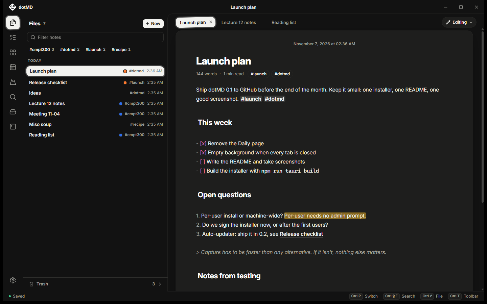
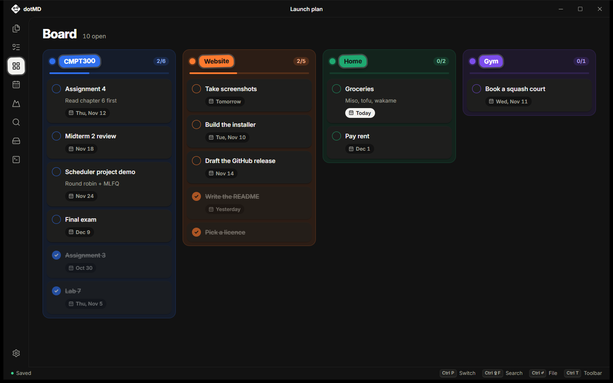
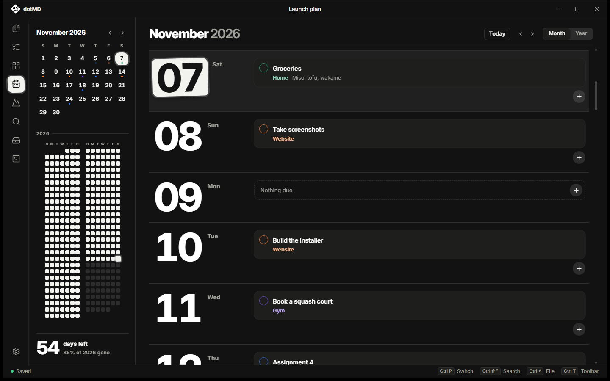
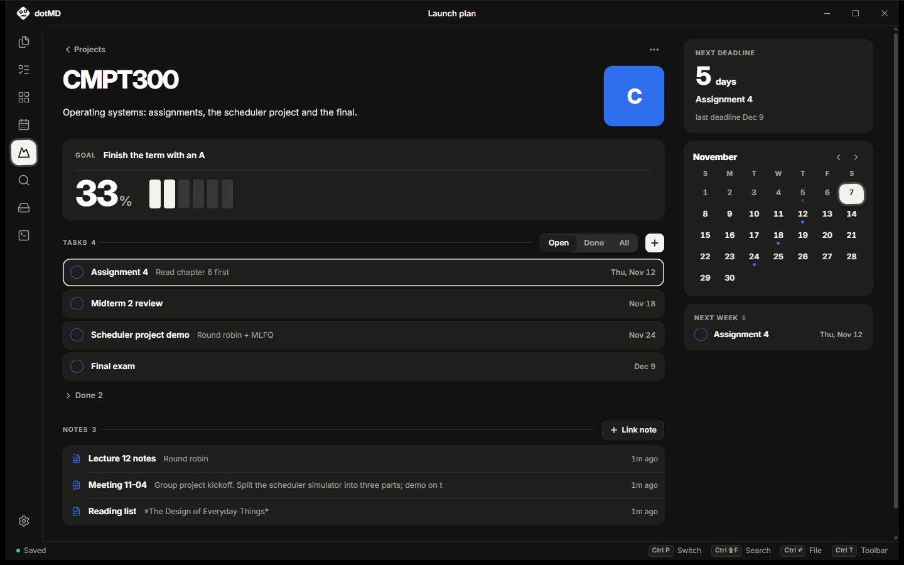

<p align="center">
  
</p>

<h1 align="center">dotMD</h1>

<p align="center">
  A fast, local Markdown scratchpad for Windows.
</p>

<p align="center">
  
</p>

---

## What it is

dotMD is a desktop notes app built for one moment: you're in the middle of
something else and need to get a thought down **right now**. Press
`Ctrl+Shift+J` from any app and dotMD appears just as you left it; `Ctrl+Shift+N`
puts the cursor in the inbox, `Ctrl+N` starts a new note. Type, press the shortcut again (or click away),
and it's gone.

Everything you write is a plain `.md` file on your own disk. There's no
account, no cloud, no sync service and no network access. Notes open fine in
any other editor, and if you stop using dotMD you keep all of it.

### Who it's for

People who live in the keyboard (developers, writers, students) and want
capture to be faster than any alternative. Every action has a shortcut, and
every shortcut can be rebound.

## How it works: inbox and archive

dotMD has one idea at its core:

- **Untitled is the inbox.** It's a single persistent note (not an unsaved
  file), one `Ctrl+Shift+N` away. Write anything. Close every tab and you get a
  quiet background with the main shortcuts instead.
- **Everything else is the archive.** When an inbox thought deserves to live
  on, press `Ctrl+Enter`. dotMD files it into its own note (named from its
  first line) and clears the inbox for the next thought.
- **`Ctrl+P` gets anything back.** Quick-open by name, or search the full
  text with `Ctrl+Shift+F`.

## Download

1. Go to [**Releases**](https://github.com/6-Clock/dotMD/releases/latest) and
   download `dotMD_<version>_x64-setup.exe`.
2. Run it. It installs for your user only (no admin prompt) and adds dotMD to
   the Start Menu.
3. Open dotMD from the Start Menu, or press `Ctrl+Shift+J` from anywhere.

Windows may show **"Windows protected your PC"** the first time, because the
installer isn't code-signed yet. Click **More info → Run anyway**.

dotMD needs Windows 10 or 11. It uses Microsoft Edge WebView2, which Windows 11
already has; on Windows 10 the installer downloads it if it's missing.
Uninstall it from **Settings → Apps** like any other app. Your notes in
`%APPDATA%\com.dotmd.app\` are kept.

## Features

**Writing**
- Live-styled Markdown: headings, bold, lists and links render as you type,
  with the Markdown markers hidden until your cursor is on that line
- Three modes, like Google Docs: **Editing** (styled), **Markdown** (raw) and
  **Viewing** (read-only, remembered per note)
- Slash commands (`/h1`, `/todo`, `/code`, `/image`, `/date`, …), a toolbar
  over selected text, and a radial format wheel when you hold `Alt`
- Drag handles to move whole blocks, focus mode and typewriter scrolling,
  page zoom

**Organising**
- Tabs, `[[note links]]` with hover previews and "Linked from" backlinks,
  and an outline beside the page on wide windows
- Inline `#tags` with a tag filter, full-text search
- Pasted images saved next to your notes and shown inline
- Deleting is never permanent by accident: notes, images, tasks and whole
  projects (with their tasks) go to one trash folder, with undo, and come
  back from Storage

**Planning**
- To-dos with subjects, deadlines and notes, kept in a readable `todo.md`;
  type due dates or pick them from a small calendar
- Right-click any task (To-do list, Board, Calendar) to mark it done, edit or
  delete it
- **Board** (one colour box per subject), **Calendar** (an agenda by day plus
  a whole-year view) and **Projects** (a page per subject with progress,
  linked notes and a deadline planner)

<table>
  <tr>
    <td width="33%"></td>
    <td width="33%"></td>
    <td width="33%"></td>
  </tr>
  <tr>
    <td align="center"><b>Board</b></td>
    <td align="center"><b>Calendar</b></td>
    <td align="center"><b>Projects</b></td>
  </tr>
</table>

**Housekeeping**
- **Storage** view: disk usage and every image, note, task, project, subject
  and tag in one place, with right-click menus, a refresh button and the trash
- Zip backups you can export and import (merge or replace)
- A built-in terminal, six themes (four light, two dark) picked from preview
  cards, a tray icon

## Your data

Release builds keep everything in `%APPDATA%\com.dotmd.app\`:

```
system/scratch.md    the inbox ("Untitled")
notes/*.md           your notes (a project's notes in notes/<Project>/)
assets/              pasted images, linked from notes as ../assets/<file>
projects/*.md        one page per project (front matter + free text)
todo.md              your to-dos, as a Markdown checklist
trash/               everything deleted, by type (notes, images, projects
                     with their tasks, tasks.md), dated, until you empty it
settings.json        settings and keybindings
theme.css            your theme
```

All of it is meant to be readable and editable by hand. A to-do, for example,
is one checklist line, with its dates tucked into an HTML comment that
Markdown viewers hide:

```markdown
- [ ] [CMPT300] Assignment 4 <!--2026-11-02T10:15:00Z|2026-12-03|Read chapter 6 first-->
```

If you change files outside the app while it's open, dotMD notices and
refreshes. Your unsaved edits always win.

## Keyboard

| Key | Action |
|---|---|
| `Ctrl+Shift+J` (anywhere) | Summon / hide dotMD |
| `Ctrl+N` | Create a new note |
| `Ctrl+Shift+N` | Open Untitled (the inbox) |
| `Ctrl+Enter` | File the inbox into its own note |
| `Ctrl+P` | Quick open or create a note |
| `Ctrl+Shift+F` | Search all notes |
| `Ctrl+/` | Editing ↔ Markdown mode |
| `Ctrl+Alt+V` | Viewing mode for this note |
| `Ctrl+W` · `Ctrl+Tab` | Close tab · next tab |
| `Ctrl+T`, then `↑` / `↓` | Move through the sidebar views |
| `Ctrl+J` | Switch between the editor and your to-dos |
| `Ctrl+Shift+B` / `C` / `P` | Board / Calendar / Projects |
| `Ctrl+Shift+U` | Storage |
| ``Ctrl+` `` · `Ctrl+Shift+T` | Terminal · new terminal |
| `Ctrl+B` | Show / hide the side panel |
| `Ctrl+Shift+M` | Focus + typewriter mode |
| `Ctrl +` / `Ctrl −` / `Ctrl 0` | Page zoom |
| hold `Alt` | Radial format wheel |

Every binding except zoom can be changed in **Settings → Keybindings**.

## Building from source

**You need:** [Node.js](https://nodejs.org) and the
[Tauri 2 prerequisites](https://v2.tauri.app/start/prerequisites/) (Rust via
rustup, plus the MSVC build tools and Windows SDK on Windows).

```sh
npm install
npm run tauri dev      # run with hot reload
npm run tauri build    # build the installer
```

The installer lands in
`src-tauri/target/release/bundle/nsis/dotMD_<version>_x64-setup.exe`.

**Releasing:** bump the version in `package.json`, `src-tauri/tauri.conf.json`
and `src-tauri/Cargo.toml`, then push a tag like `v0.1.0`. The
[Release workflow](.github/workflows/release.yml) builds the installer on
GitHub and attaches it to a draft release for you to publish.

If linking fails on Windows with `LNK1181: cannot open input file 'dbghelp.lib'`,
the Build Tools install didn't register the SDK paths. Run
`./scripts/dev.ps1` instead; it loads the MSVC environment first.

**Dev builds never touch your real notes.** `npm run tauri dev` stores
everything in `dev-data/` inside the repo (git-ignored). To point a dev run at
another folder, set `DOTMD_DATA_DIR`:

```powershell
$env:DOTMD_DATA_DIR = "$env:APPDATA\com.dotmd.app"; npm run tauri dev
```

`private/` is git-ignored too, for personal files you want next to the code.

The screenshots in `docs/screenshots/` were taken from a dev build with sample
notes, at a 1440×900 window.

**Checks:**

```sh
npx tsc --noEmit              # typecheck the frontend
cd src-tauri && cargo test    # Rust tests
```

## How the code is organised

dotMD is a [Tauri 2](https://tauri.app) app. The rule is simple: **Rust owns
files, data and the OS; React owns everything you see.** The frontend never
touches the disk. It calls typed wrappers in `src/api.ts`, which invoke Rust
commands.

```
src/                       Frontend: React 19, TypeScript, Vite, Tailwind v4
├── App.tsx                Layout, global keys, autosave, toasts
├── store.ts               App state (Zustand): notes, tabs, to-dos, views
├── api.ts                 Typed wrappers around the Rust commands
├── actions.ts             Every keyboard shortcut, in one list
├── themes.ts              Theme presets and colour tokens
├── components/            Title bar, sidebar, editor page, tabs, menus…
│   └── views/             Files, Board, Calendar, Projects, Storage, Terminal, Settings
├── editor/                CodeMirror 6 extensions: styling, links, images,
│                          slash commands, block handles, radial wheel
└── styles/globals.css     All styling

src-tauri/src/             Backend: Rust
├── lib.rs                 Startup, plugins, global shortcut, window behaviour
├── storage.rs             Notes: read, save, rename, delete, search, tags
├── trash.rs               The trash/ folder: deleted notes, images, projects, tasks
├── todo.rs                Reads and writes todo.md
├── projects.rs            Project pages (front matter + body)
├── links.rs               [[links]], backlinks, rewriting links on rename
├── images.rs              Pasted / imported images in assets/
├── vault.rs               The Storage view: sizes, trash, cleanup
├── backup.rs              Zip export and import
├── terminal.rs            The built-in terminal (a real PTY)
├── watcher.rs             Watches the data folder for outside changes
├── config.rs              settings.json and theme.css
├── shell.rs               Tray icon, show / hide window
└── migrate.rs             One-time move from the app's old name (Toc)
```

The editor is [CodeMirror 6](https://codemirror.net). Notes are saved with
atomic writes (write a temp file, then rename), so a crash can't leave a
half-written note.

`CLAUDE.md` holds the detailed module-by-module notes. `DESIGN.md` describes
the visual language: black ink on white paper, with "sticker" highlights for
whatever is active.

## License

[MIT](LICENSE)
